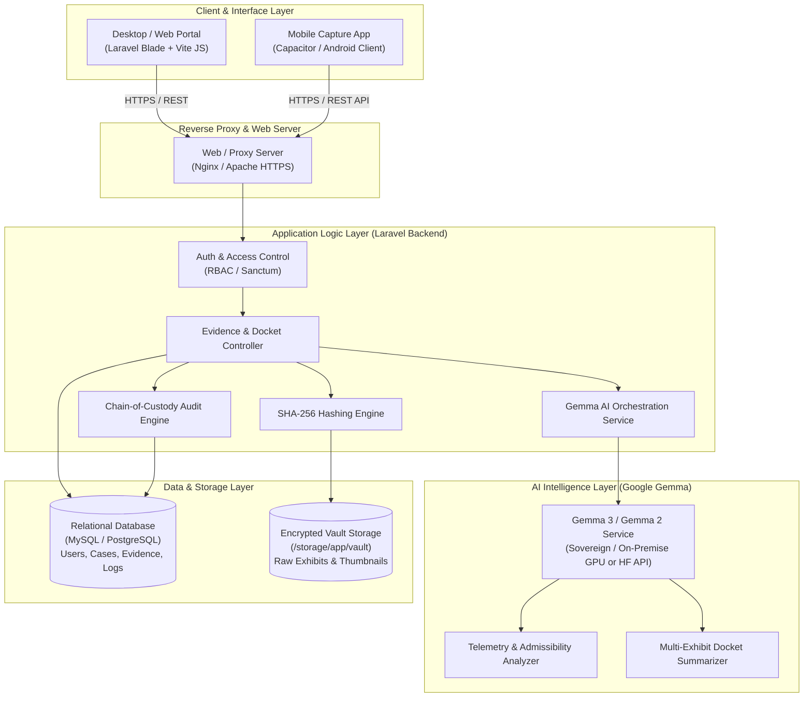
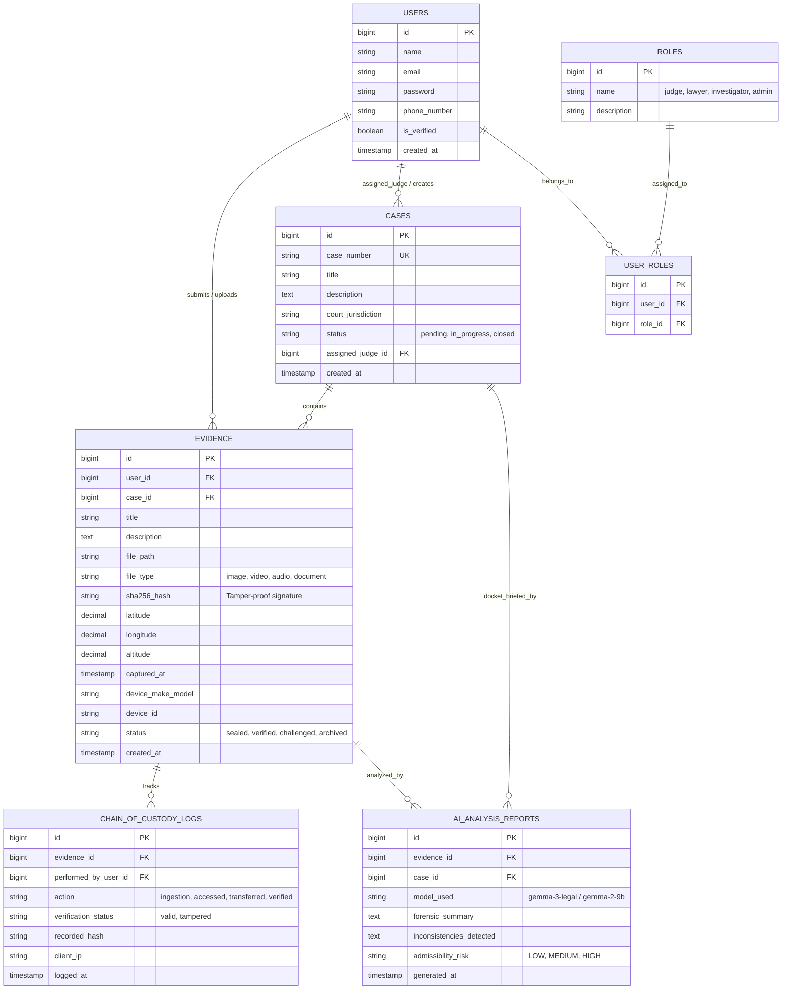
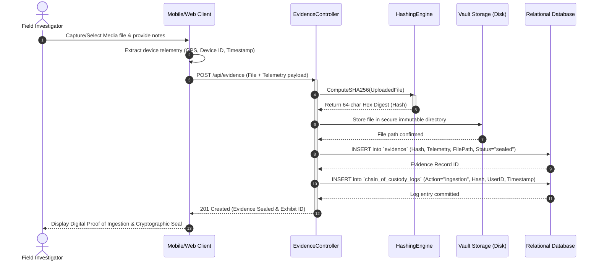
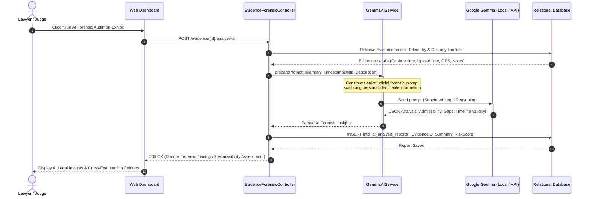
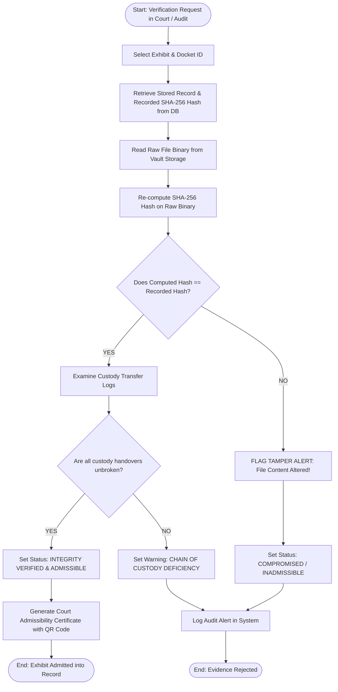
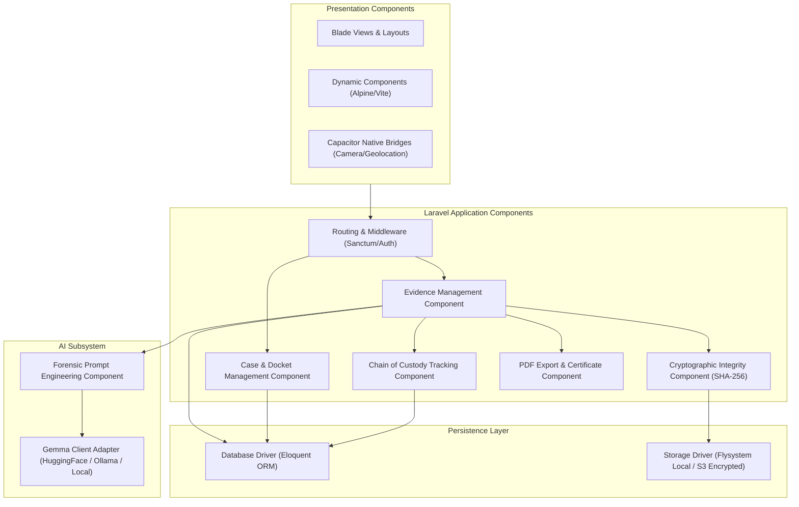
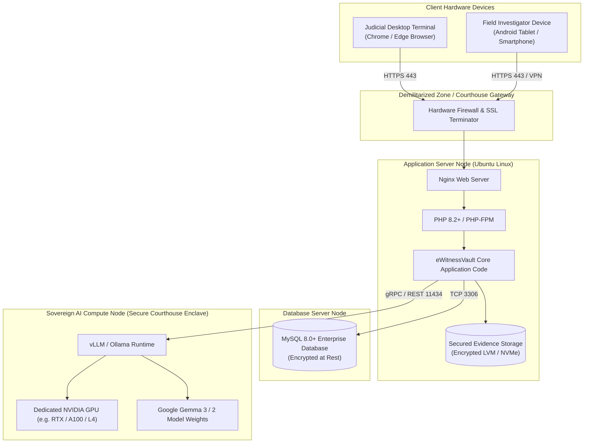

# eWitnessVault System Diagrams (Mermaid Specifications)

This document contains ready-to-use Mermaid codes for generating all the diagrams required for the **eWitnessVault** project report, technical documentation, or thesis.

You can render these directly in GitHub Markdown, Notion, Obsidian, Visual Studio Code (Markdown Preview Mermaid Support), or paste them into the online [Mermaid Live Editor](https://mermaid.live).

---

## 1. System Architecture Diagram (Multi-Tier Architecture)



---

## 2. Entity-Relationship Diagram (ERD / Database Schema)



---

## 3. UML Use Case Diagram

```mermaid
flowchart LR
    subgraph Actors
        Investigator(("Field Officer /<br/>Investigator"))
        Lawyer(("Lawyer /<br/>Prosecutor"))
        Judge(("Judge /<br/>Court Clerk"))
        Admin(("System Admin"))
        GemmaAI(("Google Gemma AI<br/>Engine"))
    end

    subgraph eWitnessVault ["eWitnessVault System"]
        UC1(["Capture & Upload Evidence"])
        UC2(["Extract Telemetry & Generate SHA-256 Seal"])
        UC3(["Manage Legal Cases & Dockets"])
        UC4(["Inspect Chain-of-Custody Trail"])
        UC5(["Verify File Integrity (Hash Check)"])
        UC6(["Run Exhibit Forensic Analysis"])
        UC7(["Generate Case Docket AI Brief"])
        UC8(["Export Admissibility Certificate (PDF)"])
        UC9(["Manage Users, Roles & AI API Config"])
    end

    Investigator --> UC1
    Investigator --> UC2
    Investigator --> UC4

    Lawyer --> UC3
    Lawyer --> UC4
    Lawyer --> UC5
    Lawyer --> UC6
    Lawyer --> UC7
    Lawyer --> UC8

    Judge --> UC3
    Judge --> UC4
    Judge --> UC5
    Judge --> UC7
    Judge --> UC8

    Admin --> UC9
    Admin --> UC4

    UC6 -.-> GemmaAI
    UC7 -.-> GemmaAI
    UC1 ..> UC2 : "<<include>>"
    UC5 ..> UC8 : "<<extend>>"
```

---

## 4. Sequence Diagram: Evidence Ingestion & Cryptographic Sealing



---

## 5. Sequence Diagram: Gemma AI Forensic Analysis Workflow



---

## 6. Activity Diagram: Evidence Verification & Admissibility Check



---

## 7. UML Component Diagram



---

## 8. Deployment Diagram (Courthouse On-Premises & Hybrid Deployment)


